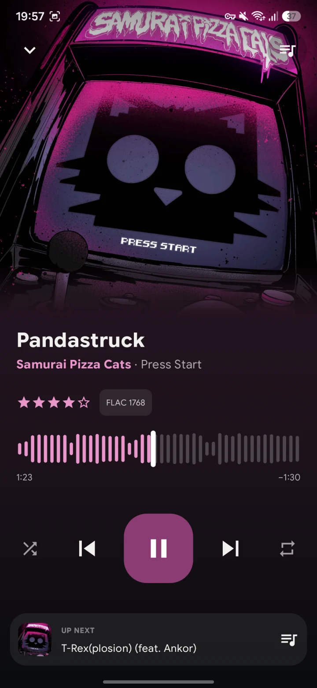
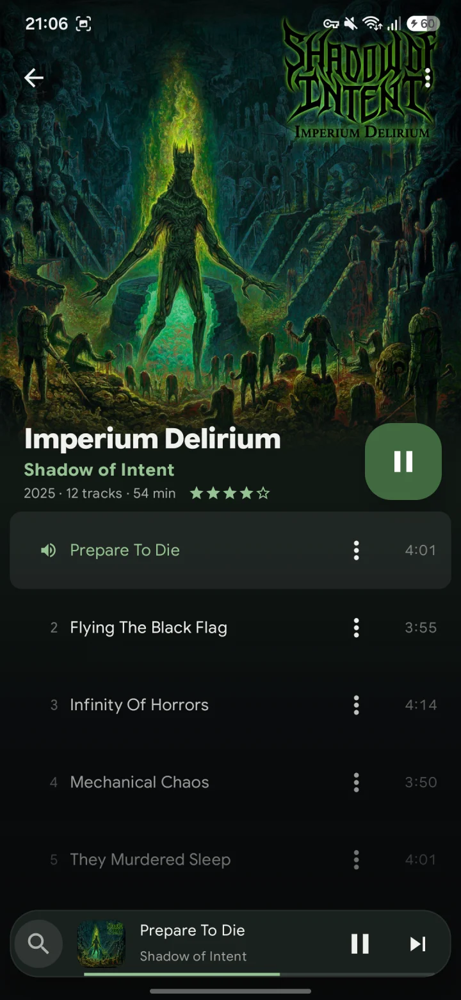
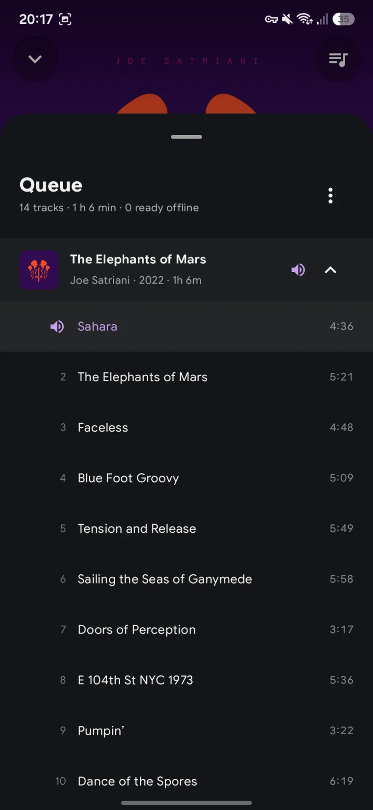
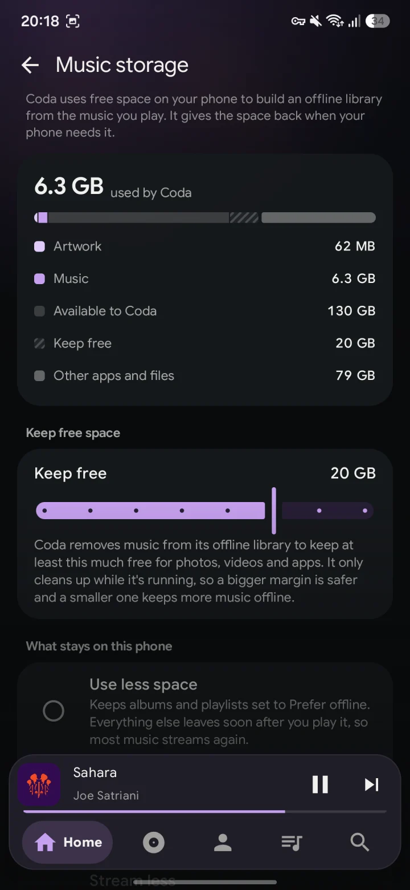

# Coda for Android

Coda is a native Android player for your own music server. It connects to
[Navidrome](https://www.navidrome.org) and other OpenSubsonic servers and puts album artwork, albums and
the play queue first. Each cover sets the colours of the screen around it. Built with Kotlin, Jetpack
Compose and Media3.

<p align="center">
  
  
  
  
</p>

- **Album first.** Discographies in release order, multi-disc albums and compilations, ratings and search.
- **A queue you can see and edit.** Reorder, remove, play next, and continue on another device through
  the server's play queue.
- **Plays your files as they are.** Original-format streaming with gapless playback, ReplayGain and
  scrobbling.
- **Offline library.** Coda keeps what you play on the phone, uses only the free space you allow, and
  gives the space back when the phone needs it.
- **Background playback.** Notification, lock screen, headset controls and Android Auto.
- **No tracking.** No analytics or ads. Coda talks only to your server.

## Install

Download the APK from [Releases](../../releases) and install it on an arm64 phone with
Android 16 (API 36) or newer. Coda isn't in an app store yet.

This is a complete rewrite. The earlier prototype (releases up to v1.1.0) used a different app id and
can't be updated to this version, so install Coda fresh.

## Build from source

This source is version 1.0.0-rc3. You need JDK 17 and the Android SDK (platform 36, build-tools
37.0.0). Set `ANDROID_HOME` to the SDK, or put `sdk.dir=...` in `local.properties`. Then run:

```sh
./gradlew :app:assembleDebug                                 # debug build
./gradlew :app:assembleRelease                               # release build, unsigned
./gradlew :core:test :app:testDebugUnitTest :store:jvmTest   # unit tests
```

The release APK is `app/build/outputs/apk/release/app-release-unsigned.apk`. Sign it with your own key
using `apksigner`. To have Gradle sign it, create `~/.coda-release.properties` (outside the repository)
with `storeFile`, `storePassword`, `keyAlias` and `keyPassword`.

## License

Copyright 2026 The Coda authors. Licensed under the [Apache License, Version 2.0](LICENSE).

Third-party notices are in `app/src/main/assets/licenses` and `app/src/main/assets/notices`. In the
app they're under Settings → About → Licences.

MP3 decoding uses a self-built Media3 FFmpeg extension (`app/libs/media3-ffmpeg-mp3-1.11.1.aar`). It contains
FFmpeg 6.0 with only the MP3 decoders, licensed under the GNU LGPL 2.1 or later. To rebuild it or
swap in your own FFmpeg libraries, see [`tools/ffmpeg-ext/README.md`](tools/ffmpeg-ext/README.md).

Coda is an independent project and isn't affiliated with or endorsed by Navidrome.
